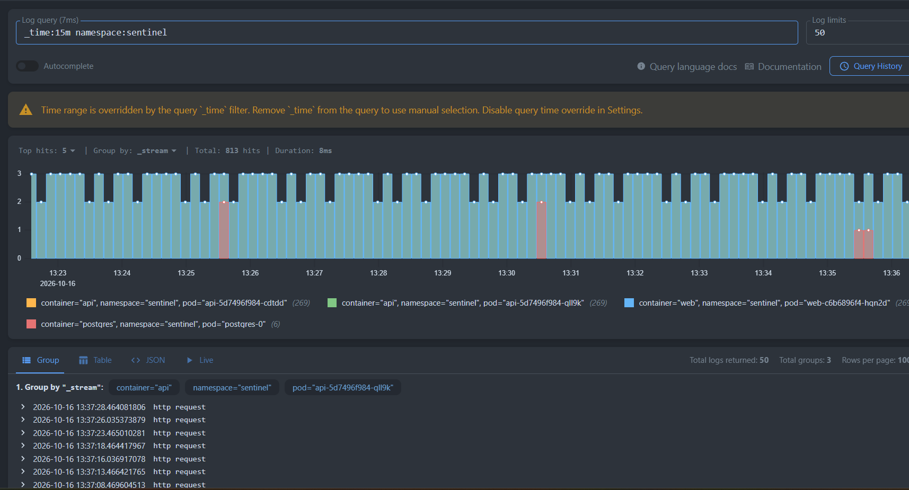
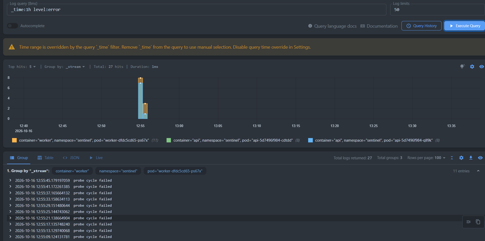
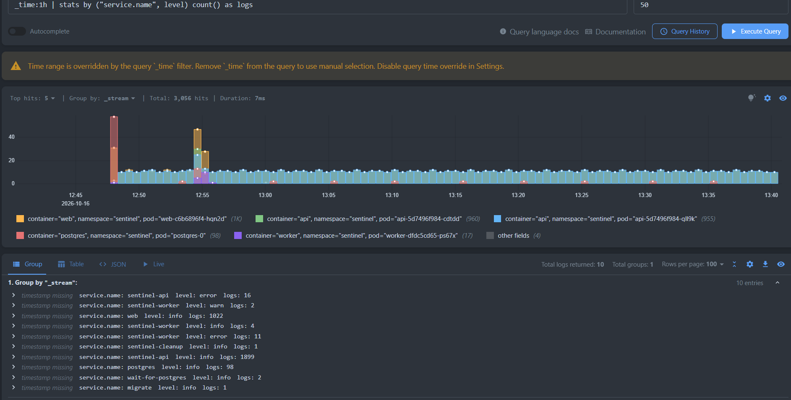
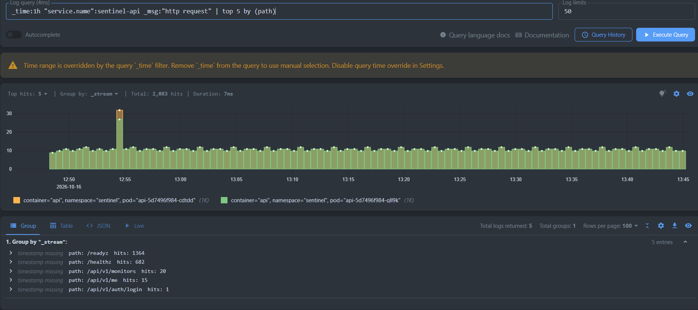
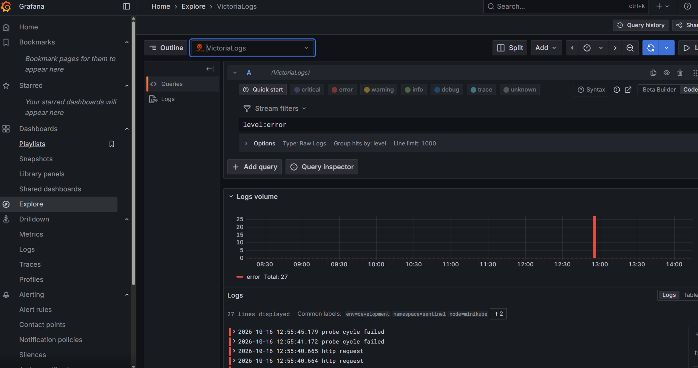

# Отчёт по ДЗ 3: сбор логов в Victoria Logs

Приложение — Sentinel, сервис мониторинга доступности сайтов. Развёрнут
в minikube в namespace `sentinel` (задание №2).

Манифесты Victoria Logs и Vector лежат в `k8s/logging/`, скриншоты —
в `screenshots/`.

Запуск:

```bash
kubectl apply -f k8s/logging/
kubectl port-forward svc/victoria-logs 9428:9428 -n logging
```

Дальше vmui открывается по адресу `http://localhost:9428/select/vmui/`.

---

## Что развернул

В отдельном namespace `logging`:

- **Victoria Logs v1.40.0** — Deployment, Service на порту 9428 и PVC на 2 ГиБ
  для хранения логов;
- **Vector 0.50.0** — DaemonSet, то есть по одному поду на каждую ноду кластера;
- для Vector — ServiceAccount и права читать поды через API Kubernetes.

Пять файлов, по файлу на смысловую часть: namespace, Victoria Logs, права
Vector, конфиг Vector, сам Vector.

---

## Как логирует приложение

Приложение пишет JSON в stdout через стандартный `log/slog`. Поля привёл
к чек-листу из семинара: переименовал `time` в `timestamp` и `msg` в `message`,
перевёл уровень в нижний регистр и добавил `service.name`. Код — в
`internal/app/logger.go`.

Одна строка лога выглядит так:

```json
{
  "timestamp": "2026-10-16T09:54:06.666482699Z",
  "level": "info",
  "message": "http request",
  "service.name": "sentinel-api",
  "method": "GET",
  "path": "/readyz",
  "status": 200,
  "duration": 824121,
  "request_id": "api-5d7496f984-qll9k/olPph3Fa49-000099"
}
```

Имя сервиса подставляется при запуске: `sentinel-api`, `sentinel-worker`
или `sentinel-cleanup`.

---

## Как логи попадают в Victoria Logs

Vector читает файлы логов контейнеров в `/var/log/pods` на ноде, добавляет
к каждой записи метаданные Kubernetes (под, namespace, контейнер, нода),
разбирает JSON приложения и отправляет всё по HTTP в Victoria Logs.

**Почему DaemonSet.** Логи контейнеров лежат файлами на ноде, поэтому один
агент на ноду собирает их сразу со всех подов. Вариант с сайдкаром потребовал
бы добавить контейнер в каждый Deployment приложения — то есть менять
манифесты приложения ради сбора логов.

**Почему Vector.** Конфиг читается как конвейер: откуда брать, что сделать,
куда отправить. Есть готовый источник `kubernetes_logs`, который сам
подтягивает метаданные, и язык VRL для разбора JSON. Fluent Bit или
OpenTelemetry Collector подошли бы не хуже.

**Почему эндпоинт `/insert/jsonline`.** Vector шлёт туда обычный POST, а какое
поле чем является, задаётся прямо в адресе:

```
/insert/jsonline?_msg_field=message&_time_field=timestamp&_stream_fields=namespace,pod,container
```

То есть в манифесте сразу видно, что сообщение берётся из `message`, время —
из `timestamp` самого приложения, а не из момента приёма.

**Почему манифесты, а не Helm.** Всё приложение развёрнуто обычными
манифестами, и логирование сделал так же. В файле видно, какой у шиппера
конфиг и куда он шлёт; у Helm это было бы спрятано в шаблонах чарта.

Логи приложения попадают в хранилище разобранными по полям, а логи nginx
и PostgreSQL — просто текстом, потому что они не в JSON.

---

## Запросы

### (а) Сырые записи за 15 минут

```logsql
_time:15m namespace:sentinel
```

Обычный поток логов приложения — 813 записей за 15 минут. Видно четыре
источника: две реплики API, nginx и PostgreSQL. На гистограмме поток ровный,
всплесков нет.



### (б) Фильтр по полю: только ошибки

```logsql
_time:1h level:error
```

27 записей уровня `error`. Все собраны в одном всплеске в 12:55 — это момент,
когда я специально остановил базу, чтобы в логах появились ошибки. Видно
сообщение воркера `probe cycle failed`, 11 записей от него и по 8 от каждой
реплики API.

Фильтр идёт по полю `level`, а не поиском по тексту — ради этого логи
и пишутся в JSON.



### (в) Группировка: сколько записей от каждого сервиса

```logsql
_time:1h | stats by ("service.name", level) count() as logs
```

Сводка за час по источникам и уровням:

| service.name | level | logs |
|---|---|---|
| sentinel-api | info | 1899 |
| sentinel-api | error | 16 |
| web | info | 1022 |
| postgres | info | 98 |
| sentinel-worker | error | 11 |
| sentinel-worker | info | 4 |
| sentinel-worker | warn | 2 |
| wait-for-postgres | info | 2 |
| migrate | info | 1 |
| sentinel-cleanup | info | 1 |

Сразу понятно, кто сколько пишет и у кого ошибки. В выборку попали и разовые
процессы: миграции, init-контейнер ожидания базы и запуск очистки по
расписанию.



### (г) Агрегация: самые частые эндпоинты API

```logsql
_time:1h "service.name":sentinel-api _msg:"http request" | top 5 by (path)
```

| path | hits |
|---|---|
| /readyz | 1364 |
| /healthz | 682 |
| /api/v1/monitors | 20 |
| /api/v1/me | 15 |
| /api/v1/auth/login | 1 |

Запрос показывает неожиданную вещь: почти все обращения к API — это проверки
самого Kubernetes. `/readyz` опрашивается каждые 5 секунд, `/healthz` — каждые
10, и на две реплики за час выходит больше двух тысяч запросов против примерно
36 настоящих.

Вывод на будущее: служебные эндпоинты лучше не логировать вовсе или писать
на уровне `debug`, иначе они заглушают реальный трафик.



---

## Бонус: плагин Victoria Logs для Grafana

Развернул Grafana в том же namespace `logging` — манифест
`k8s/logging/30-grafana.yaml`. Плагин ставится при запуске переменной
окружения:

```yaml
- name: GF_INSTALL_PLUGINS
  value: victoriametrics-logs-datasource
```

Источник данных не настраивается руками, а прописан в ConfigMap, который
монтируется в каталог провижининга Grafana:

```yaml
datasources:
  - name: VictoriaLogs
    type: victoriametrics-logs-datasource
    url: http://victoria-logs.logging.svc.cluster.local:9428
    isDefault: true
```

Поэтому после `kubectl apply` источник уже подключён и проверка выдаёт
`Data source is working`.

Доступ: `kubectl port-forward svc/grafana 3000:3000 -n logging`,
дальше `http://localhost:3000`, логин `admin`, пароль из Secret
`grafana-admin`.

В Grafana тот же запрос из пункта (б) работает через раздел Explore: виден
всплеск ошибок и сами записи `probe cycle failed`.



Одно отличие от vmui: в Grafana период задаётся её собственным селектором
времени, а не фильтром `_time:` внутри запроса. Если написать `_time:1h`
при выбранном в Grafana часе, периоды пересекутся и выборка может оказаться
пустой — поэтому в Grafana запрос пишется без `_time:`.
