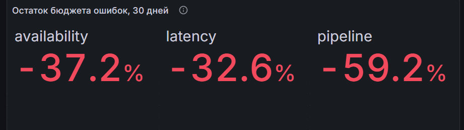
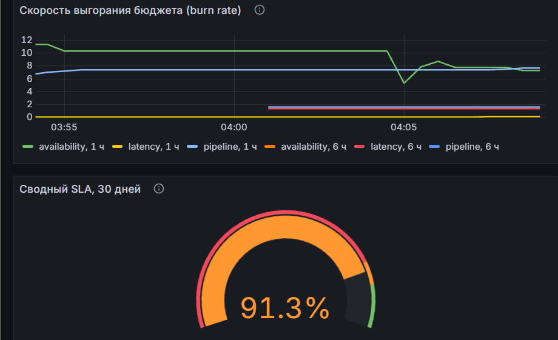

# Отчёт по ДЗ 5: SLI, SLO и SLA

Приложение — Sentinel, сервис мониторинга доступности сайтов, развёрнут
в minikube. Метрики собирает Victoria Metrics из ДЗ 4, SLI считает vmalert
(`k8s/monitoring/sli-rules.yaml`), графики — дашборд `Sentinel SLO` в Grafana.

## Материалы

| Что | Где |
|---|---|
| Скринкаст демонстрации | `screencast-dz5.mp4` |
| Остаток бюджета ошибок | `screenshots/dz5-error-budget.png` |
| Burn rate и сводный SLA | `screenshots/dz5-burn-rate-sla.png` |
| Результат прогона | раздел 8 этого отчёта |

Дашборд: Grafana → папка `Sentinel` → `Sentinel SLO`
(`k8s/logging/31-grafana-dashboards.yaml`).

---

## 1. Выбранные метрики

Все три метрики реализованы в ДЗ 4.

| Метрика | Тип | Метки | Что означает |
|---|---|---|---|
| `sentinel_http_requests_total` | counter | `service`, `method`, `route`, `status` | обработанные HTTP-запросы; `route` — шаблон маршрута, а не путь |
| `sentinel_http_request_duration_seconds` | histogram | `service`, `method`, `route` | время обработки запроса |
| `sentinel_probes_total` | counter | `service`, `kind`, `result` | выполненные проверки мониторов |

Каждая покрывает свой класс отказа: первая — ошибки API, вторая — медленные
ответы, третья — остановку конвейера проверок, которую первые две не видят
(HTTP-слой при этом здоров).

Для второй метрики шкала бакетов гистограммы переведена с `prometheus.DefBuckets`
на явную с точным краем `0.3` (`internal/infra/metrics/buckets.go`): порог SLO
обязан совпадать с краем бакета, иначе доля быстрых запросов считается
по чужому порогу.

---

## 2. Пробер

Пакет `internal/blackbox`, процесс `cmd/prober`, деплой `k8s/70-prober.yaml`.
Раз в 10 секунд проходит сценарий пользовательского пути: `GET /healthz`,
`GET /readyz`, `POST /api/v1/auth/login`, `GET /api/v1/monitors` с токеном,
`GET /api/v1/public/status/{slug}`. Сценарий успешен, только если прошли
все шаги.

Пробер даёт непрерывный трафик известной частоты — на нём считаются
request-based индикаторы. Его метрики: `sentinel_sli_probe_total{step,result}`,
`sentinel_sli_probe_duration_seconds{step}`, `sentinel_sli_step_success{step}`,
`sentinel_sli_journey_success`.

---

## 3. SLI и формулы

**SLI-1. Доступность API** — доля запросов пользователя без внутренней ошибки.
Подход request-based: каждый запрос сам по себе успешен или нет.

```promql
sum(rate(sentinel_http_requests_total{service="sentinel-api",route!~"/healthz|/readyz|unmatched",status!~"5.."}[$w]))
/
sum(rate(sentinel_http_requests_total{service="sentinel-api",route!~"/healthz|/readyz|unmatched"}[$w]))
```

**SLI-2. Скорость API** — доля запросов быстрее 300 мс. Подход request-based.

```promql
sum(rate(sentinel_http_request_duration_seconds_bucket{service="sentinel-api",route!~"/healthz|/readyz",le="0.3"}[$w]))
/
sum(rate(sentinel_http_request_duration_seconds_count{service="sentinel-api",route!~"/healthz|/readyz"}[$w]))
```

**SLI-3. Живость конвейера проверок** — доля минут, в которые воркер выполнял
проверки. Подход time-based: у непрерывного процесса нет запросов, которые
можно поделить на успешные и неуспешные.

```promql
avg_over_time(((sum(rate(sentinel_probes_total[1m])) or vector(0)) > bool 0)[$w:1m])
```

`or vector(0)` обязателен: когда воркер остановлен, рядов нет вовсе, и без
подстановки нуля индикатор показал бы разрыв вместо падения до нуля.

Проверки живости исключены из первых двух: их дёргает kubelet, а не пользователь.

---

## 4. SLO и бюджет ошибок

Окно — 30 дней, скользящее.

| SLO | Цель | Бюджет ошибок |
|---|---|---|
| Доступность API | 99.5 % | 0.5 % запросов, около 3 ч 36 мин простоя |
| Скорость API | 95 % запросов быстрее 300 мс | 5 % запросов |
| Живость конвейера | 99 % минут | 7 ч 12 мин |

```promql
остаток бюджета = 1 - (1 - SLI) / (1 - SLO)
burn rate       = (1 - SLI за окно) / (1 - SLO)
```

Остаток `1` — бюджет целый, `0` — исчерпан. Burn rate `1` — бюджет тратится
ровно по норме и закончится к концу окна, `14.4` — сгорит за двое суток.

---

## 5. SLA

Sentinel гарантирует доступность API не ниже **99.0 %** за календарный месяц
при времени ответа p95 не выше **500 мс**.

Из расчёта исключаются объявленные окна обслуживания, недоступность целей
мониторинга, заведённых пользователем, и ответы 4xx. При нарушении — продление
оплаченного периода на 10 % месяца, при доступности ниже 95 % — на 30 %.

SLA мягче SLO намеренно: бюджет ошибок выгорает раньше, чем нарушается
обещание, и у команды остаётся время на реакцию.

**Сводный SLA по набору SLO** — произведение целей:

```
0.995 × 0.95 × 0.99 = 0.9358
```

---

## 6. Графики

Дашборд `Sentinel SLO` (`k8s/logging/31-grafana-dashboards.yaml`): три панели
SLI с линией цели, панель пробера, остаток бюджета ошибок, burn rate на окнах
1 ч и 6 ч, гейдж сводного SLA и шаги сценария пробера.

Готовые ряды пишет vmalert, панели их только читают. Серии различаются меткой
`slo`, поэтому бюджет и burn rate считаются одним правилом на все SLO:

```promql
sentinel:sli:ratio5m{slo="availability"|"latency"|"pipeline"}
sentinel:slo_target:ratio{slo=...}
sentinel:error_budget_remaining:ratio30d{slo=...}
sentinel:burn_rate:ratio1h{slo=...}
sentinel:sla_compound:ratio30d
```

Те же запросы работают в vmui.

---

## 7. Изменения приложения для скринкаста

Добавлена управляемая деградация — middleware
`internal/transport/http/middleware/chaos.go`, по умолчанию выключена,
при `APP_ENV=production` включение отклоняется на старте.

| Переменная | Что делает |
|---|---|
| `CHAOS_ERROR_RATE` | доля запросов к `/api/`, на которые возвращается 503 |
| `CHAOS_LATENCY` | задержка перед обработкой |
| `CHAOS_LATENCY_RATE` | доля запросов, которые задерживаются |
| `CHAOS_READYZ_FAIL` | `/readyz` отвечает 503 |

Сбой вносится до того, как chi определит маршрут, поэтому middleware сначала
сам сопоставляет путь с деревом маршрутов и проставляет шаблон в контекст:
иначе метрика пометила бы запрос как `unmatched`, а эта метка из SLI
доступности исключена, и внесённый сбой на графике не был бы виден.

Сбои вносятся только в `/api/`: 503 на `/healthz` заставил бы kubelet
перезапускать поды, и вместо деградации вышло бы падение. Middleware стоит
последним в цепочке, после метрик и логирования, чтобы внесённый сбой попал
в метрики.

Скрипты: `scripts/slo-load.sh` — фоновая нагрузка на API,
`scripts/chaos.sh` — переключение режимов (`errors 0.5`, `latency 800ms 1`,
`readyz on|off`, `off`).

### Сценарий демонстрации

| Шаг | Действие | Что видно на графиках |
|---|---|---|
| 1 | базовая линия | все SLI около 100 %, бюджет целый |
| 2 | `scripts/chaos.sh errors 0.5` | SLI доступности падает под линию SLO, растёт burn rate; остальные индикаторы не тронуты |
| 3 | `chaos.sh off`, `kubectl scale deploy/worker --replicas=0` | падает только SLI конвейера, доступность восстановилась |
| 4 | `kubectl scale deploy/worker --replicas=1` | графики возвращаются к норме |

---

## 8. Результат прогона

Состояние кластера во время демонстрации:

```
$ kubectl get pods -n sentinel
api-68b7df7f9b-26w6q      1/1   Running
api-68b7df7f9b-xmdj7      1/1   Running
postgres-0                2/2   Running
prober-5bff578f77-jbtv8   1/1   Running
web-c6b6896f4-hqn2d       1/1   Running
worker-...                1/1   Running   # на шаге 3 масштабируется в 0
```

Значения `sentinel:sli:ratio5m` до и во время деградации:

| SLO | База | `chaos.sh errors 0.5` | Воркер в 0 реплик |
|---|---|---|---|
| availability | 1.000 | **0.800** | 1.000 |
| latency | 1.000 | 1.000 | 1.000 |
| pipeline | 1.000 | 1.000 | **0.000** |
| journey (пробер) | 1.000 | **0.400** | 1.000 |

Каждая деградация двигает ровно тот индикатор, за который отвечает,
и не трогает остальные. Burn rate доступности на часовом окне при этом
вырос с 0 до **11.8**.

Длинные окна за тот же прогон — скриншоты из `screenshots/`:





Остаток бюджета ушёл в минус по всем трём SLO, сводный SLA — **91.3 %**
против целевых 93.58 %. Тридцатидневное окно помнит выгорание и не
восстанавливается вместе с короткими окнами: в этом и смысл бюджета ошибок.
